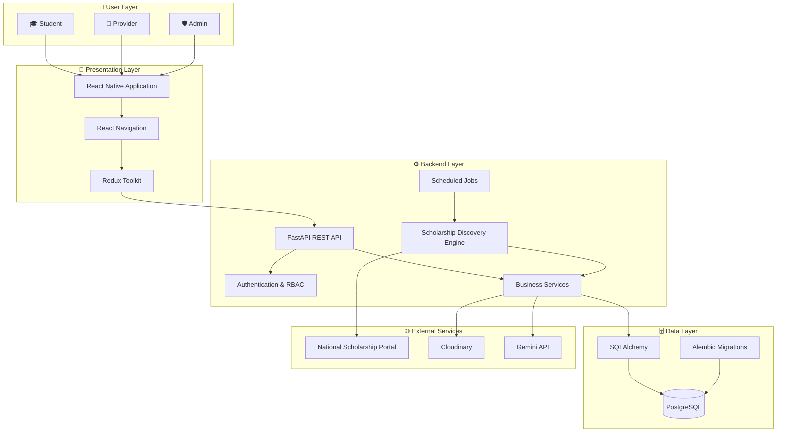
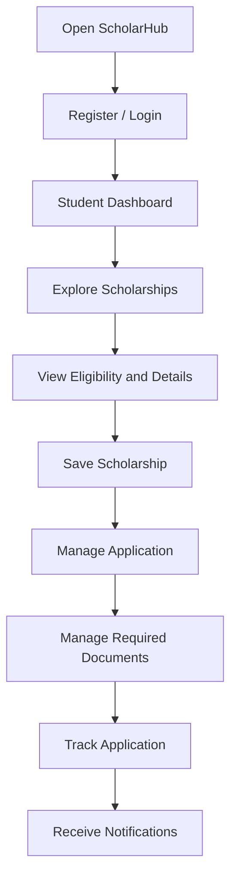
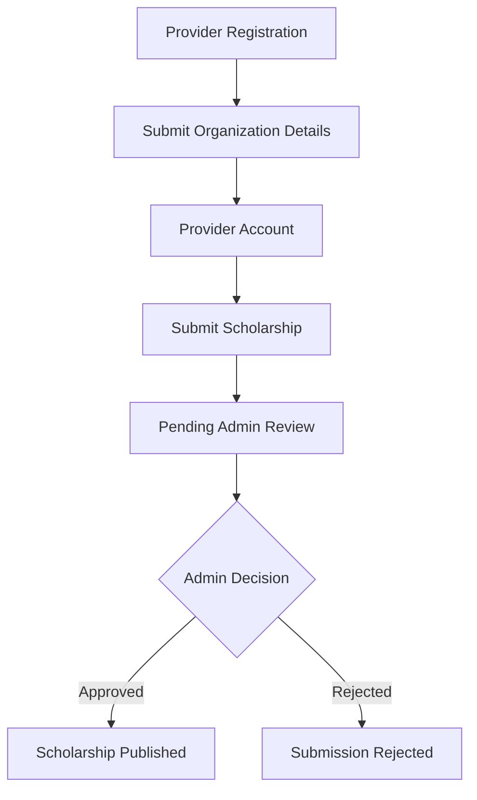
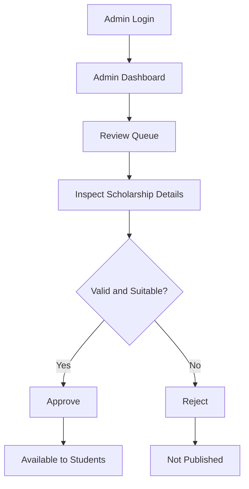
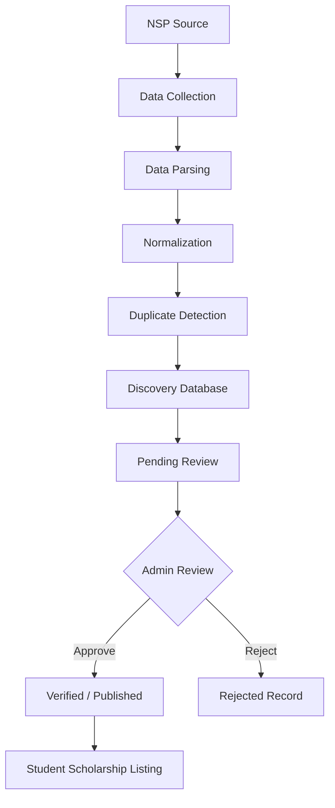
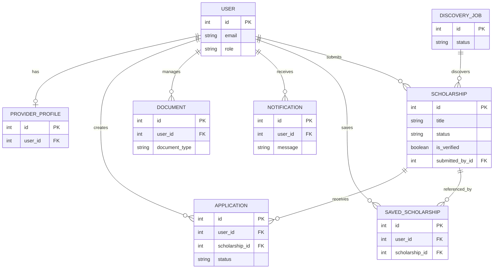

 <div align="center">

# 🎓 ScholarHub

### *Discover Opportunities. Unlock Your Potential.*

**A Unified Scholarship Discovery & Management Platform**

A role-based platform designed to simplify scholarship discovery, organize applications, connect scholarship providers, and make educational opportunities more accessible.

<p>
  
  
  
  
  
</p>

[Overview](#-overview) •
[Problem Statement](#-problem-statement) •
[Solution](#-our-solution) •
[Features](#-key-features) •
[Architecture](#-system-architecture) •
[Tech Stack](#-technology-stack) •
[Setup](#-installation-and-setup) •
[Roadmap](#-future-roadmap)

</div>

---

## 📌 Table of Contents

- [🌟 Overview](#-overview)
- [❗ Problem Statement](#-problem-statement)
- [💡 Our Solution](#-our-solution)
- [🚀 Key Features](#-key-features)
- [👥 User Roles](#-user-roles)
- [🏗️ System Architecture](#️-system-architecture)
- [🛠️ Technology Stack](#️-technology-stack)
- [🔄 System Design and Workflows](#-system-design-and-workflows)
- [🔍 Automated Scholarship Discovery](#-automated-scholarship-discovery)
- [🗄️ Database Design](#️-database-design)
- [🔐 Security and Privacy](#-security-and-privacy)
- [📂 Project Structure](#-project-structure)
- [⚡ Installation and Setup](#-installation-and-setup)
- [🔑 Environment Configuration](#-environment-configuration)
- [🧪 Testing](#-testing)
- [🛣️ Future Roadmap](#️-future-roadmap)
- [🌍 Expected Impact](#-expected-impact)
- [🤝 Contributing](#-contributing)
- [⚠️ Disclaimer](#️-disclaimer)
- [👨‍💻 Contact](#-contact)

---

## 🌟 Overview

**ScholarHub** is a centralized, role-based scholarship discovery and management platform built to help students find educational funding opportunities and manage their entire scholarship journey from a single interface.

Scholarship information is often distributed across multiple websites and portals. Students may find it difficult to identify relevant opportunities, understand eligibility criteria, organize documents, track application deadlines, and monitor application progress.

ScholarHub addresses these challenges through a centralized, role-based platform that brings together three core stakeholders:

- **🎓 Students** – Discover and manage scholarship opportunities.
- **🏢 Providers** – Submit scholarship opportunities through an organized workflow.
- **🛡️ Administrators** – Review, approve, and manage scholarship information.

> **Our Vision:** To make scholarship discovery more organized, accessible, and reliable for every student.

---

## ❗ Problem Statement

Students frequently face challenges across every stage of searching and applying for scholarships:

| Existing Challenge | Real-World Impact |
| :--- | :--- |
| **Scattered Scholarship Information** | Students must search across multiple platforms and portals. |
| **Complex Eligibility Requirements** | Students struggle to identify suitable opportunities they qualify for. |
| **Missed Deadlines** | Lack of centralized tracking causes students to lose valuable opportunities. |
| **Document Management Difficulties** | Important academic and identity documents become difficult to organize. |
| **Lack of Centralized Tracking** | Students struggle to monitor ongoing application progress. |
| **Unverified Scholarship Information** | Incorrect or outdated listings can mislead applicants. |

**The Core Problem:** Students need more than a static scholarship listing website—they need an organized system to discover, evaluate, and manage opportunities from start to finish.

---

## 💡 Our Solution

ScholarHub provides a unified platform that connects **scholarship discovery** with **application management** and **administrative review**. Instead of treating scholarships as isolated listings, ScholarHub organizes the complete scholarship journey:

1. **Collect** scholarship information from supported external sources.
2. **Normalize & Process** discovered records into a consistent schema.
3. **Identify Duplicates** to prevent redundant scholarship entries.
4. **Queue for Review** by sending newly discovered, unverified opportunities for administrative review.
5. **Publish** approved opportunities according to strict visibility rules.
6. **Empower Students** to discover, compare, and manage relevant opportunities.

This combination of automation and human review helps maintain a structured, trustworthy scholarship ecosystem.

---

## 🚀 Key Features

### 🎓 Student Module

| Feature | Description |
| :--- | :--- |
| **Student Registration** | Create an account and access the platform. |
| **Scholarship Discovery** | Browse and filter available scholarship opportunities. |
| **Scholarship Details** | View detailed scholarship information and eligibility criteria. |
| **Saved Scholarships** | Save opportunities for later reference and review. |
| **Scholarship Comparison** | Compare selected scholarship opportunities side-by-side. |
| **Application Tracking** | Monitor scholarship application information and real-time status. |
| **Document Management** | Upload, replace, and manage required application documents. |
| **Notifications** | Access timely application-related notifications and alerts. |
| **Student Dashboard** | View a unified overview of scholarships and application progress. |
| **Study Abroad** | Explore study-abroad-related opportunities available in the platform. |

### 🏢 Provider Module
- Provider registration with organization details.
- Provider authentication and session management.
- Dedicated provider dashboard.
- Structured scholarship submission workflow.
- Administrative review before public listing.
- Role-based access to provider functionality.

### 🛡️ Admin Module
- Administrative authentication and access controls.
- User and role management across the platform.
- Provider profile review and approval.
- Scholarship moderation and lifecycle management.
- NSP discovery review queue.
- Approve or reject auto-discovered scholarships.
- Manage scholarship publication visibility.
- Monitor discovery job history and execution status.

### ⚙️ Automated Scholarship Discovery
- Automated NSP scholarship data collection.
- Data parsing and schema normalization.
- Duplicate record detection.
- Discovery job execution tracking.
- Configurable scheduled collection.
- Mandatory administrative review before publication.

---

## 👥 User Roles

| Role | Primary Capabilities | Access Scope |
| :--- | :--- | :--- |
| **🎓 Student** | Browse, save, compare scholarships; upload documents; track applications. | Student screens & personal records |
| **🏢 Provider** | Register organization; submit and manage scholarship listings. | Provider dashboard & own submissions |
| **🛡️ Administrator** | Approve providers; moderate scholarships; manage discovery queues & users. | Full system moderation & administration |

---

## 🏗️ System Architecture

ScholarHub follows a **layered client-server architecture**. The mobile application communicates with the backend through REST APIs, while the backend handles authentication, business logic, authorization, scholarship discovery processing, and database operations.

### High-Level Architecture



### Architecture Layers

| Layer | Responsibility |
| :--- | :--- |
| **Presentation Layer** | Mobile screens and interactive user flows. |
| **State Management Layer** | Centralized frontend state using Redux Toolkit. |
| **API Layer** | REST communication between frontend and backend. |
| **Authentication Layer** | User authentication and role-based authorization (RBAC). |
| **Business Logic Layer** | Scholarship, provider, document, and application operations. |
| **Discovery Layer** | Automated scholarship collection and processing. |
| **Data Access Layer** | Database operations through SQLAlchemy. |
| **Database Layer** | Persistent relational storage using PostgreSQL. |
| **External Integration Layer** | NSP, Cloudinary, and Google Gemini API integrations. |

---

## 🛠️ Technology Stack

### Frontend
| Technology | Purpose |
| :--- | :--- |
| **React Native** | Cross-platform mobile application development. |
| **Expo** | React Native development, builds, and tooling. |
| **TypeScript** | Type-safe application development. |
| **Redux Toolkit** | Global state management. |
| **React Navigation** | Screen navigation and role-based routing. |

### Backend
| Technology | Purpose |
| :--- | :--- |
| **Python 3.11+** | Backend programming language. |
| **FastAPI** | High-performance REST API development. |
| **SQLAlchemy 2.x** | Database ORM and asynchronous database operations. |
| **Alembic** | Version-controlled database schema migrations. |
| **Pydantic** | Data validation and serialization. |

### Database & Storage
| Technology | Purpose |
| :--- | :--- |
| **PostgreSQL** | Primary relational database. |
| **Cloudinary** | Document and file storage integration. |

### External Integrations
| Integration | Purpose |
| :--- | :--- |
| **National Scholarship Portal (NSP)** | Automated scholarship discovery source. |
| **Google Gemini API** | AI service integration. |

---

## 🔄 System Design and Workflows

### 1. Student Workflow


### 2. Provider Workflow


### 3. Admin Workflow


---

## 🔍 Automated Scholarship Discovery

ScholarHub includes an automated discovery pipeline connected to the **National Scholarship Portal (NSP)** to reduce manual effort in collecting and organizing scholarship information.

### Discovery Pipeline



### Discovery Workflow Components

| Component | Responsibility |
| :--- | :--- |
| **Source Connector** | Collects scholarship information from NSP. |
| **Parser** | Extracts relevant scholarship fields. |
| **Normalizer** | Converts extracted information into a consistent structure. |
| **Deduplicator** | Identifies duplicate records before insertion. |
| **Discovery Job Manager** | Tracks collection execution and run results. |
| **Scheduler** | Runs collection jobs periodically when enabled. |
| **Review Queue** | Holds newly discovered records for administrative review. |
| **Publication Workflow** | Controls which approved records become publicly visible. |

> **Important Design Decision — Human-in-the-Loop Verification:** Automation does not automatically mean information is trustworthy. ScholarHub uses administrative review to control the publication of newly discovered, unverified scholarships. Newly discovered opportunities remain pending until an administrator verifies them, reducing the risk of publishing incorrect or outdated listings.

---

## 🗄️ Database Design

ScholarHub uses **PostgreSQL** as its relational database to support user, scholarship, provider, application, document, and discovery workflows.

### Conceptual Entity-Relationship Diagram



*Note: This is a conceptual relationship diagram illustrating major platform entities rather than every physical database column or constraint.*

### Database Management
- **PostgreSQL** for persistent relational storage.
- **SQLAlchemy** for asynchronous ORM operations.
- **Alembic** for version-controlled schema migrations.
- Structured records and foreign-key constraints for data consistency.

---

## 🔐 Security and Privacy

ScholarHub enforces role-based access patterns to separate student, provider, and administrator functionality:

- Authentication through secure backend APIs.
- Role-based authorization (RBAC) across endpoints and screens.
- Restricted administrative moderation operations.
- Protected provider and scholarship management workflows.
- Backend-controlled scholarship publication visibility.
- Strict document access controls.
- Secure handling of student application data.
- Environment-based configuration for sensitive credentials.

> **Privacy Principle:** Student documents and personal information are accessible only to authorized users and services for legitimate application purposes.

---

## 📂 Project Structure

*The following is a high-level representation of the repository organization; actual filenames and directories may vary.*

```text
ScholarHub/
│
├── 📱 frontend/
│   ├── src/
│   │   ├── components/
│   │   ├── navigation/
│   │   ├── screens/
│   │   │   ├── dashboard/
│   │   │   ├── scholarships/
│   │   │   ├── applications/
│   │   │   ├── documents/
│   │   │   ├── notifications/
│   │   │   ├── provider/
│   │   │   ├── admin/
│   │   │   └── profile/
│   │   ├── services/
│   │   ├── slices/
│   │   └── types/
│   │
│   ├── app.json
│   ├── package.json
│   └── tsconfig.json
│
├── ⚙️ backend/
│   ├── app/
│   │   ├── api/
│   │   ├── core/
│   │   ├── models/
│   │   ├── schemas/
│   │   ├── services/
│   │   ├── routes/
│   │   ├── discovery/
│   │   └── cli/
│   │
│   ├── alembic/
│   ├── tests/
│   ├── requirements.txt
│   └── main.py
│
├── 📚 docs/
│   └── project documentation
│
└── README.md
```

---

## ⚡ Installation and Setup

Follow these steps to run ScholarHub locally.

### Prerequisites
Install the following before starting:
- **Python 3.11** (or compatible project version)
- **Node.js and npm**
- **PostgreSQL**
- **Git**
- **Expo-compatible development environment** (Expo Go app or Android/iOS emulator)

### 1. Clone the Repository
```bash
git clone YOUR_REPOSITORY_URL
cd ScholarHub
```

### 2. Backend Setup
Navigate to the backend directory, create a virtual environment, install dependencies, and start the server:

```bash
cd backend
python -m venv .venv
```

Activate the virtual environment:
```powershell
# Windows PowerShell
.\.venv\Scripts\Activate.ps1
```
```bash
# macOS / Linux
source .venv/bin/activate
```

Install dependencies, apply migrations, and start FastAPI:
```bash
pip install -r requirements.txt
# Configure required environment variables in .env before migrating
alembic upgrade head
uvicorn app.main:app --reload --port 8000
```

Interactive backend API documentation will be available at: **`http://localhost:8000/docs`**

### 3. Frontend Setup
Open another terminal, navigate to the frontend/project root directory, install packages, and launch Expo:

```bash
cd ScholarHub
npm install
npm run start
```

Use the Expo development workflow to open the app on a physical device or emulator.

### 4. Verify the Application
- [ ] Backend server starts successfully on port `8000`.
- [ ] PostgreSQL database connection is active and migrations are applied.
- [ ] Frontend connects to the configured backend API address.
- [ ] User authentication and role-based navigation work properly.
- [ ] Scholarship discovery and administrative review workflows operate end-to-end.

---

## 🔑 Environment Configuration

Create the required `.env` configuration files for your backend and frontend services.

### Example Backend Configuration (`backend/.env`)
```env
DATABASE_URL=your_postgresql_connection_string

SECRET_KEY=your_secure_secret_key

CLOUDINARY_CLOUD_NAME=your_cloudinary_cloud_name
CLOUDINARY_API_KEY=your_cloudinary_api_key
CLOUDINARY_API_SECRET=your_cloudinary_api_secret

GEMINI_API_KEY=your_gemini_api_key

DISCOVERY_SCHEDULE_ENABLED=false
```

### Example Frontend Configuration (`frontend/.env`)
```env
EXPO_PUBLIC_API_URL=http://YOUR_LOCAL_NETWORK_IP:8000
```

> **Important Configuration Guidelines:**
> - Variable names above are illustrative—match them with the settings defined in your codebase.
> - Replace all placeholders with your own valid credentials.
> - **Never** commit `.env` files, API keys, passwords, or database credentials to version control.
> - Use your machine's local network IP (rather than `localhost`) when testing on a physical mobile device.
> - Enable scheduled discovery (`DISCOVERY_SCHEDULE_ENABLED=true`) only after configuring and validating your environment.

---

## 🧪 Testing

### Frontend TypeScript Validation
```bash
npx tsc --noEmit
```

### Backend Automated Test Suite
From the `backend` directory:
```powershell
# Windows PowerShell
.venv\Scripts\python.exe -m pytest
```
```bash
# macOS / Linux
.venv/bin/python -m pytest
```

### Areas Covered by the Backend Test Suite
- Authentication & session security
- User roles and permissions (RBAC)
- Scholarship CRUD and publication operations
- Administrative moderation workflows
- Provider registration and submission workflows
- Notification delivery
- Document management
- Automated scholarship discovery
- Student application workflows

*Note: The project reported 145 passing backend tests and zero TypeScript compilation errors during the mock-data cleanup milestone. These are milestone-specific results and not a guarantee that every future build shares the same status.*

---

## 🛣️ Future Roadmap

| Planned Enhancement | Expected Benefit |
| :--- | :--- |
| **Advanced Eligibility Matching** | Help students automatically identify the most relevant opportunities. |
| **More Verified Scholarship Sources** | Expand the available scholarship ecosystem across portals. |
| **Multilingual Support** | Improve platform accessibility for diverse student populations. |
| **Personalized Recommendations** | Enhance scholarship discovery using profile and activity signals. |
| **Improved Deadline Reminders** | Help students avoid missed application deadlines. |
| **Analytics Dashboard** | Provide actionable insights into discovery and application activity. |
| **Enhanced Document Privacy Controls** | Strengthen protection and lifecycle controls for sensitive student files. |
| **Scholarship Outcome Tracking** | Help students monitor final application results and awards. |

*Note: Roadmap items may include planned features that are not yet implemented.*

---

## 🌍 Expected Impact

### For Students
- More organized, centralized scholarship discovery.
- Clearer access to eligibility criteria and opportunity details.
- Better application tracking and organization.
- Centralized, secure document management.

### For Scholarship Providers
- Structured scholarship submission pipelines.
- Dedicated provider management workflows.
- Pre-publication administrative review for quality assurance.

### For Administrators
- Centralized scholarship moderation.
- Controlled publication of auto-discovered opportunities.
- Full visibility into automated discovery job history.
- Streamlined platform operations.

*Our long-term objective is to bridge the gap between students and educational funding opportunities.*

---

## 🤝 Contributing

Contributions, suggestions, and improvements are welcome!

1. **Fork** the repository.
2. **Create** a new feature branch:
   ```bash
   git checkout -b feature/your-feature-name
   ```
3. **Implement** your changes and run the test suite.
4. **Commit** your changes with a clear description:
   ```bash
   git add .
   git commit -m "Add: your feature description"
   ```
5. **Push** to your branch and open a **Pull Request**:
   ```bash
   git push origin feature/your-feature-name
   ```

---

## ⚠️ Disclaimer

ScholarHub is an educational project developed to improve scholarship discovery and management. Scholarship information should always be verified against the relevant official source before applying. ScholarHub does not represent or claim official affiliation with the National Scholarship Portal (NSP) or any government organization unless such affiliation is formally established. The availability, eligibility, deadlines, and terms of individual scholarships are determined solely by their respective authorities.

---

## 👨‍💻 Contact

- **Project:** ScholarHub
- **Developed by:** ScholarHub Development Team
- **Questions & Collaboration:** Please use the repository's **Issues** section for questions, bug reports, or collaboration inquiries.

---

<div align="center">

### 🎓 ScholarHub
**Making Scholarship Opportunities Easier to Discover.**  
*Discover. Organize. Apply. Achieve.*

⭐ **If you find this project interesting, consider giving the repository a star!**

</div>
