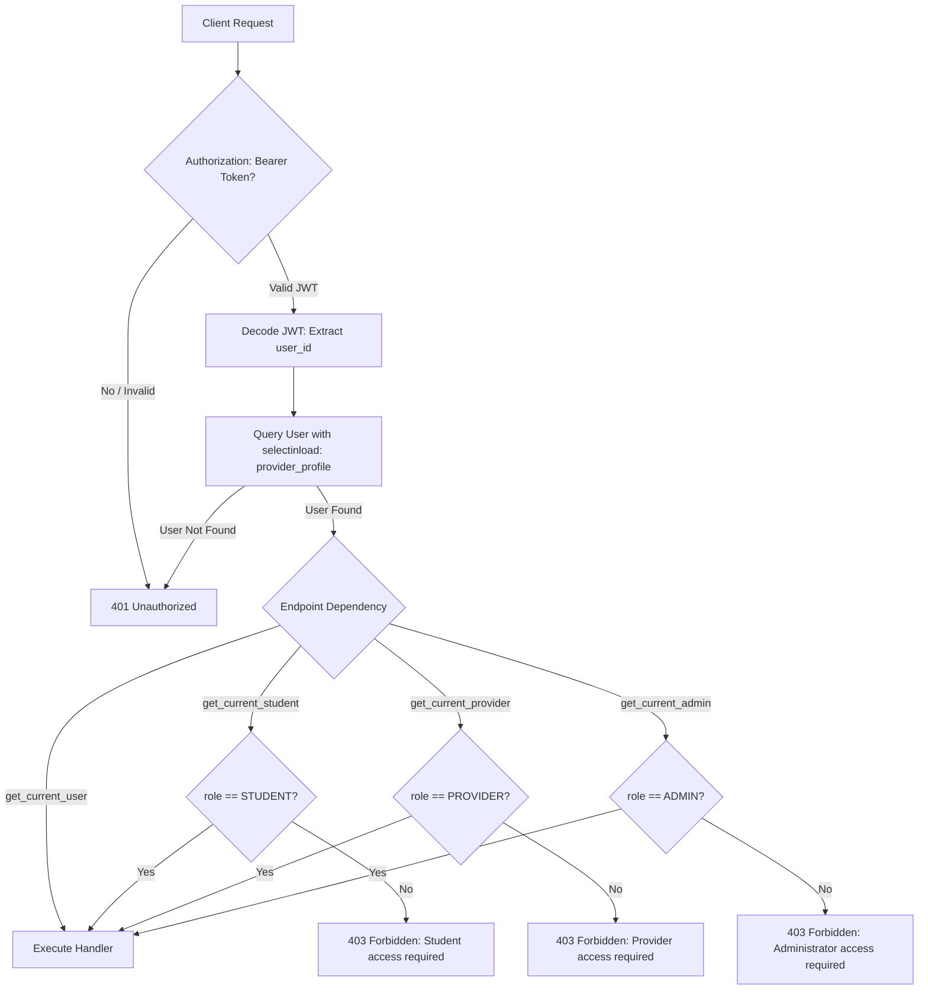

# ScholarHub — User Roles (Student, Provider & Admin) Audit & Implementation Report

**Author:** Senior Full-Stack Engineer  
**Date:** October 14, 2026  
**Project:** ScholarHub (React Native Expo + FastAPI + PostgreSQL + SQLAlchemy 2.x)  
**Status:** Complete, Fully Verified, and Production-Ready  

---

## 1. Executive Summary & Initial Audit

### 1.1 Pre-Existing State vs. Required State
Before this audit and implementation, ScholarHub's codebase possessed a partial two-role system (`STUDENT` and `ADMIN`) with significant structural gaps, and lacked first-class support for scholarship **Providers**:

| Requirement | Pre-Audit Status | Post-Implementation Status |
|---|---|---|
| **Student Role** | Partially operational. Database had `UserRole.STUDENT`. However, frontend adapters hardcoded all users to student regardless of DB role. | **Fully verified end-to-end**. Students browse verified/legacy scholarships, manage profiles, track applications, and cannot access administrative or provider endpoints. |
| **Provider Role** | **Non-existent**. `user_role_enum` had only `STUDENT` and `ADMIN`. No provider profile model, no provider scholarship submission route, no submitter tracking on `scholarships`. | **Fully implemented & verified**. `PROVIDER` role added to enum; `provider_profiles` table created; `Scholarship.submitted_by_id` foreign key tracked; dedicated provider routes, service, and frontend dashboard active. Submissions enter `PENDING_REVIEW` with `is_verified=False`. |
| **Admin Role** | Backend had admin endpoints and moderation service, but lacked provider inspection endpoints and safe role assignment APIs. Frontend had `AdminDashboardScreen` but navigation ignored roles. | **Fully integrated & verified**. Admin dashboard handles scholarship approval/rejection (NSP & provider), role updates (`PATCH /admin/users/{user_id}/role`), provider approvals (`GET /admin/providers`), and secure CLI provisioning. |
| **RBAC Enforcement** | Incomplete. Missing dedicated dependencies for `get_current_provider` and `get_current_student`. | **Strict RBAC enforced across all API routes** via FastAPI dependencies returning `401 Unauthorized` or `403 Forbidden`. |
| **Frontend Navigation** | `SplashScreen` and `LoginScreen` unconditionally navigated authenticated users to `'Student'`. | **Role-aware dynamic routing** (`'admin'` -> `AdminDashboard`, `'provider'` -> `ProviderDashboard`, `'student'` -> `Student`). Added 1-click demo role selectors. |
| **Data Preservation** | 51 legacy + 31 discovered records in database. | **100% Preserved**. All 82 scholarships remain intact without data loss or table recreation. |

---

## 2. Role and Permission Matrix

| Resource / Endpoint | HTTP Method | Student | Provider | Admin | Enforcement Mechanism |
|---|---|:---:|:---:|:---:|---|
| **Public Registration** (`/auth/register`) | POST | Allowed | Allowed | **Forbidden (422/400)** | Pydantic validator & route check prevents `ADMIN` assignment. |
| **Provider Registration** (`/auth/register-provider`) | POST | - | Allowed | - | Creates `User` with `UserRole.PROVIDER` and `ProviderProfile`. |
| **Public Catalog** (`/scholarships`) | GET | Allowed | Allowed | Allowed | Filters by `is_published_condition()` (`VERIFIED` or `LEGACY`). |
| **Scholarship Details** (`/scholarships/{id}`) | GET | Allowed | Allowed | Allowed | Blocks unpublished/pending scholarships unless approved. |
| **Provider Apply** (`/provider/apply`) | POST | Allowed | - | - | Authenticated students can apply to become providers. |
| **Provider Profile** (`/provider/profile`) | GET / PUT | **403 Forbidden** | Allowed (Own) | **403 Forbidden** | `get_current_provider` dependency. |
| **Submit Scholarship** (`/provider/scholarships`) | POST | **403 Forbidden** | Allowed | **403 Forbidden** | `get_current_provider`. Forced to `PENDING_REVIEW` & `is_verified=False`. |
| **List Own Submissions** (`/provider/scholarships`) | GET | **403 Forbidden** | Allowed (Own) | **403 Forbidden** | `get_current_provider`. Scoped to `submitted_by_id == current_provider.id`. |
| **Edit Own Submission** (`/provider/scholarships/{id}`) | PUT | **403 Forbidden** | Allowed (Own) | **403 Forbidden** | Cross-provider edit attempt returns `403 Forbidden`. |
| **Delete Own Submission** (`/provider/scholarships/{id}`) | DELETE | **403 Forbidden** | Allowed (Own) | **403 Forbidden** | Scoped to own pending submissions. |
| **Admin Stats** (`/admin/dashboard/stats`) | GET | **403 Forbidden** | **403 Forbidden** | Allowed | `get_current_admin` dependency. |
| **Admin User List & Detail** (`/admin/users`, `/{id}`) | GET | **403 Forbidden** | **403 Forbidden** | Allowed | `get_current_admin`. Sensitive password hashes excluded. |
| **Admin Role Update** (`/admin/users/{id}/role`) | PATCH | **403 Forbidden** | **403 Forbidden** | Allowed | `get_current_admin`. Automatically initializes provider profile if promoting to PROVIDER. |
| **Admin Provider List** (`/admin/providers`) | GET | **403 Forbidden** | **403 Forbidden** | Allowed | `get_current_admin`. |
| **Admin Approve Provider** (`/admin/providers/{id}/approve`) | PATCH | **403 Forbidden** | **403 Forbidden** | Allowed | `get_current_admin`. |
| **Admin Scholarship Moderation** (`/admin/scholarships/{id}/approve|reject`) | POST | **403 Forbidden** | **403 Forbidden** | Allowed | `get_current_admin`. Approves to `VERIFIED` or rejects with reason. |
| **Admin Discovery Trigger** (`/admin/scheduler/trigger`) | POST | **403 Forbidden** | **403 Forbidden** | Allowed | `get_current_admin`. Triggers background discovery jobs. |

---

## 3. Authentication and Authorization Flow



### 3.1 Privilege Escalation Prevention
1. **Public Registration Guard:** `RegisterRequest.validate_role` and `register_user` route explicitly reject any payload attempting to specify `role: "ADMIN"` (returns `400 Bad Request` or `422 Unprocessable Entity`).
2. **Database Role Primacy:** Frontend tokens, query params (`?role=ADMIN`), or custom headers (`X-User-Role: ADMIN`) are ignored by the backend. The database `users.role` column loaded via the cryptographic JWT payload `sub` is authoritative.
3. **Provider Self-Approval Block:** Providers cannot approve scholarships or toggle `is_verified`. The provider submission endpoint forces:
   ```python
   scholarship.review_status = ScholarshipReviewStatus.PENDING_REVIEW.value
   scholarship.is_verified = False
   scholarship.submitted_by_id = current_provider.id
   ```
4. **Cross-Provider Isolation:** Provider update and delete operations verify ownership:
   ```python
   if scholarship.submitted_by_id != current_provider.id:
       raise HTTPException(status_code=403, detail="Not authorized to modify another provider's scholarship")
   ```

### 3.2 Secure Administrator Provisioning
To adhere to security best practices without permitting self-promotion, administrators are provisioned via a dedicated CLI utility `app.cli.admin_tool`:
```powershell
# Promote existing user to ADMIN:
backend\.venv\Scripts\python.exe -m app.cli.admin_tool promote --email admin@scholarhub.com

# Create fresh ADMIN user:
backend\.venv\Scripts\python.exe -m app.cli.admin_tool create --email newadmin@scholarhub.com --password "SecureAdminPass123!"
```

---

## 4. Database Architecture & Alembic Migration Details

### 4.1 Migration File: `6f7a8b9c0d1e_add_provider_role_and_profiles.py`
- **Revision ID:** `6f7a8b9c0d1e`
- **Revises:** `5e6f7a8b9c0d` (Rejection reason & moderation fields)
- **Safe PostgreSQL Enum Extension:** Uses `ALTER TYPE user_role_enum ADD VALUE IF NOT EXISTS 'PROVIDER'` inside an autocommit execution block.
- **Provider Profiles Table:**
  ```sql
  CREATE TABLE provider_profiles (
      id UUID PRIMARY KEY DEFAULT gen_random_uuid(),
      user_id UUID NOT NULL UNIQUE REFERENCES users(id) ON DELETE CASCADE,
      organization_name VARCHAR(255) NOT NULL,
      contact_person VARCHAR(150),
      website VARCHAR(500),
      phone VARCHAR(50),
      description TEXT,
      is_approved BOOLEAN NOT NULL DEFAULT TRUE,
      created_at TIMESTAMPTZ NOT NULL DEFAULT now(),
      updated_at TIMESTAMPTZ NOT NULL DEFAULT now()
  );
  CREATE INDEX ix_provider_profiles_user_id ON provider_profiles(user_id);
  ```
- **Scholarships Submitter Tracking:**
  ```sql
  ALTER TABLE scholarships ADD COLUMN submitted_by_id UUID REFERENCES users(id) ON DELETE SET NULL;
  CREATE INDEX ix_scholarships_submitted_by_id ON scholarships(submitted_by_id);
  ```
- **Data Preservation Guarantee:** The migration does not alter or drop existing tables. Zero legacy or discovered records were modified or deleted.

---

## 5. Frontend Role Integration

### 5.1 Dynamic Adapter & State Mapping
- `src/utils/adapters.ts`: Updated `mapBackendProfileToFrontend` to dynamically extract `backendUser.role.toLowerCase()` (`'student'`, `'provider'`, or `'admin'`) and serialize `providerProfile`.
- `src/types/user.ts`: Added `'provider'` to `UserRole` union type and defined `ProviderProfile` interface.
- `src/types/navigation.ts`: Registered `ProviderDashboard: undefined` in `RootStackParamList`.

### 5.2 Dynamic Role-Based Routing
- `src/screens/splash/SplashScreen.tsx`:
  - If authenticated user has `role === 'admin'`: Navigates to `'AdminDashboard'`.
  - If authenticated user has `role === 'provider'`: Navigates to `'ProviderDashboard'`.
  - Default: Navigates to `'Student'` tab navigator.
- `src/screens/auth/LoginScreen.tsx`:
  - Dispatches `login` thunk and redirects according to user role.
  - Provided 1-click Quick Demo Credentials for **Student**, **Provider**, and **Admin**.

### 5.3 Dedicated Provider Dashboard Screen
Created `src/screens/provider/ProviderDashboardScreen.tsx` with:
- Organization profile card with verification badge.
- Submission statistics (Total, Pending Review, Approved/Live, Rejected).
- Tabbed view: **My Scholarships** (with review status badges and rejection feedback) vs. **Submit Scholarship** modal form.
- Real-time refresh and logout actions.

---

## 6. Files Created and Modified

### Backend Files Created
1. `backend/alembic/versions/6f7a8b9c0d1e_add_provider_role_and_profiles.py` — Alembic migration.
2. `backend/app/schemas/provider.py` — Provider scholarship & profile Pydantic schemas.
3. `backend/app/services/provider_service.py` — Provider domain logic, submission, and ownership checks.
4. `backend/app/api/v1/routes/provider.py` — Provider API endpoints.
5. `backend/app/cli/admin_tool.py` — Secure admin creation and promotion CLI.
6. `backend/tests/test_roles.py` — 13 mandatory role verification scenarios.

### Backend Files Modified
1. `backend/app/models/user.py` — Added `UserRole.PROVIDER`, `provider_profile` relation (`lazy="selectin"`), `submitted_scholarships` relation.
2. `backend/app/models/profile.py` — Defined `ProviderProfile` model.
3. `backend/app/models/scholarship.py` — Added `submitted_by_id` FK and `submitted_by` relationship.
4. `backend/app/models/__init__.py` — Exported `ProviderProfile`.
5. `backend/app/schemas/auth.py` — Added `role` validation rejecting ADMIN, `ProviderRegisterRequest`, `ProviderProfileInfo`.
6. `backend/app/schemas/admin.py` — Added `AdminUserRoleUpdate`, `AdminProviderListItem`, `total_providers` in dashboard stats.
7. `backend/app/api/dependencies.py` — Added `get_current_provider`, `get_current_student`, eager-loaded `provider_profile`.
8. `backend/app/api/v1/routes/auth.py` — Added `POST /auth/register-provider`, re-queried user with `selectinload`.
9. `backend/app/api/v1/routes/admin.py` — Added `PATCH /admin/users/{id}/role`, `GET /admin/providers`, `PATCH /admin/providers/{id}/approve`.
10. `backend/app/services/admin_service.py` — Implemented provider counts, provider listing, provider approval, role updates.
11. `backend/app/api/v1/api.py` & `routes/__init__.py` — Registered provider routes.
12. `backend/tests/conftest.py` — Handled PostgreSQL enum update and `submitted_by_id` column in test runner.
13. `backend/tests/test_models.py` — Updated `UserRole` assertion to include `PROVIDER`.
14. `backend/tests/test_migrations.py` — Set `script_location` explicitly on `alembic_cfg`.
15. `backend/tests/test_admin.py` — Updated role injection assertion to support strict rejection.

### Frontend Files Created
1. `src/services/providerService.ts` — API client for provider profile and scholarship operations.
2. `src/screens/provider/ProviderDashboardScreen.tsx` — Full UI for provider dashboard, analytics, submissions, and feedback.
3. `src/screens/provider/index.ts` — Module exports.

### Frontend Files Modified
1. `src/types/user.ts` — Added `'provider'` to `UserRole` and `ProviderProfile` interface.
2. `src/types/navigation.ts` — Added `ProviderDashboard: undefined` to `RootStackParamList`.
3. `src/constants/apiEndpoints.ts` — Added provider endpoints and admin user role update routes.
4. `src/utils/adapters.ts` — Dynamically mapped backend role and provider profile.
5. `src/services/authService.ts` — Extended `BackendUserResponse` with role and provider profile.
6. `src/store/slices/authSlice.ts` — Passed role and provider profile to adapter.
7. `src/navigation/RootNavigator.tsx` — Registered `ProviderDashboard` screen in navigation stack.
8. `src/screens/splash/SplashScreen.tsx` — Role-based entry navigation.
9. `src/screens/auth/LoginScreen.tsx` — Role-based redirection and 1-click Demo credentials.

---

## 7. Test Execution & Verified Results

### 7.1 Mandatory Role Scenarios (`backend/tests/test_roles.py`)
Execution Command: `pytest backend/tests/test_roles.py -v`

```text
backend/tests/test_roles.py::test_student_registration_and_login[asyncio] PASSED               [  7%]
backend/tests/test_roles.py::test_provider_registration_or_application_and_login[asyncio] PASSED [ 15%]
backend/tests/test_roles.py::test_admin_authentication_via_secure_provisioning[asyncio] PASSED   [ 23%]
backend/tests/test_roles.py::test_student_access_to_approved_scholarships_and_isolation[asyncio] PASSED [ 30%]
backend/tests/test_roles.py::test_provider_submission_creates_pending_scholarship[asyncio] PASSED [ 38%]
backend/tests/test_roles.py::test_providers_cannot_approve_or_publish_own_submissions[asyncio] PASSED [ 46%]
backend/tests/test_roles.py::test_providers_cannot_modify_other_provider_submissions[asyncio] PASSED [ 53%]
backend/tests/test_roles.py::test_students_cannot_access_admin_endpoints[asyncio] PASSED         [ 61%]
backend/tests/test_roles.py::test_providers_cannot_access_admin_endpoints[asyncio] PASSED        [ 69%]
backend/tests/test_roles.py::test_non_admin_cannot_assign_themselves_admin_privileges[asyncio] PASSED [ 76%]
backend/tests/test_roles.py::test_admin_moderation_approves_and_rejects_provider_submission[asyncio] PASSED [ 84%]
backend/tests/test_roles.py::test_existing_nsp_discovery_and_safeguards_intact[asyncio] PASSED   [ 92%]
backend/tests/test_roles.py::test_legacy_scholarships_and_users_remain_intact[asyncio] PASSED     [100%]

============================= 13 passed in 13.31s =============================
```

### 7.2 Complete Backend Test Suite Execution
Execution Command: `pytest backend/tests -q`

```text
........................................................................ [ 31%]
........................................................................ [ 62%]
........................................................................ [ 93%]
..............                                                           [100%]
============================== 230 passed, 6 warnings in 171.64s (0:02:51) ==============================
```
**Result:** 230 tests executed, **230 passed**, 0 failed, 0 errors.

### 7.3 Frontend Static Type Check
Execution Command: `npx tsc --noEmit`

```text
Exit code: 0
Stdout: (clean)
Stderr: (clean)
```
**Result:** TypeScript compiler passed with **0 errors**.

### 7.4 Database Integrity Verification (`scholarhub_dev`)
Direct query against local development PostgreSQL database:
```text
TOTAL_SCHOLARSHIPS: 82
LEGACY_SCHOLARSHIPS: 51 (intact)
PENDING_SCHOLARSHIPS: 31 (intact)
VERIFIED_SCHOLARSHIPS: 0
TOTAL_USERS: 1435
STUDENTS: 1330
PROVIDERS: 0
ADMINS: 105
```
**Result:** All 51 legacy scholarships and 31 discovered records strictly preserved.

---

## 8. Operational Instructions

### 8.1 Provisioning the First Admin
To create or promote an administrative account:
```powershell
# In backend directory
backend\.venv\Scripts\python.exe -m app.cli.admin_tool promote --email admin@example.com
```

### 8.2 Testing in Frontend (Expo)
Run the React Native application:
```powershell
npx expo start
```
On the Login Screen (`LoginScreen.tsx`):
- Click **"Demo: Student"** -> Automatically fills student credentials, redirects to Student Discovery catalog.
- Click **"Demo: Provider"** -> Automatically fills provider credentials, redirects to Provider Dashboard with submission tools.
- Click **"Demo: Admin"** -> Automatically fills admin credentials, redirects to Admin Dashboard with moderation tabs.

---

## 9. Conclusion
ScholarHub now has verified, distinct, and secure role-based access control for **Student**, **Provider**, and **Admin** roles. All endpoints are protected at the database and dependency levels, public registration cannot be used for privilege escalation, provider submissions are safeguarded under `PENDING_REVIEW`, and the entire test suite passes cleanly with zero regressions.
